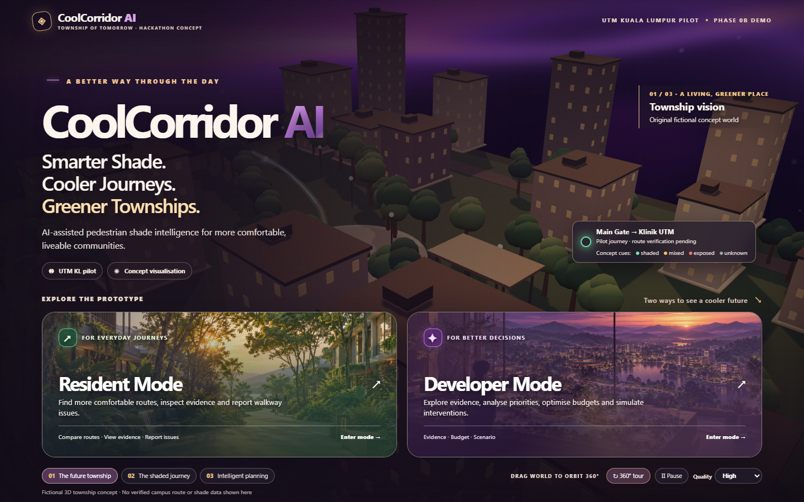
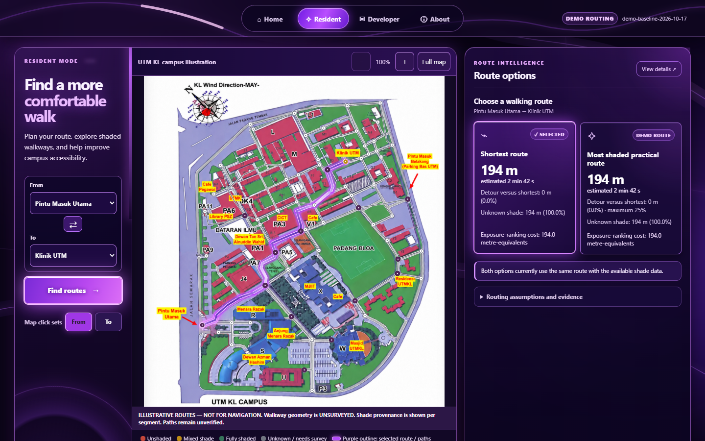
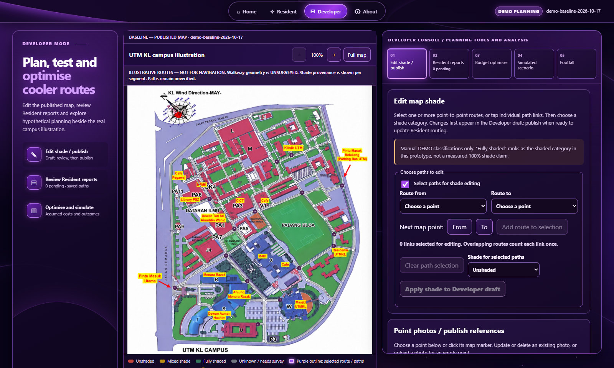

# CoolCorridor AI

**A campus shade-awareness, pedestrian route-planning and improvement-planning prototype.**

[**Open the live demo**](https://coolcorridor-ai-demo.vercel.app/) · [GitHub repository](https://github.com/lejun10290000/coolcorridor-ai-demo)

> **Project status:** Interactive demo / prototype. The current application demonstrates Resident and Developer workflows using illustrative data. It is not a surveyed navigation system, a live campus monitoring service, or a production multi-user administration platform.



## Table of contents

- [Overview](#overview)
- [Problem and proposed approach](#problem-and-proposed-approach)
- [Features](#features)
- [User journeys](#user-journeys)
- [Technology stack](#technology-stack)
- [System design](#system-design)
- [Getting started](#getting-started)
- [Tests and quality checks](#tests-and-quality-checks)
- [Data, privacy and important limitations](#data-privacy-and-important-limitations)
- [Deployment](#deployment)
- [Repository structure](#repository-structure)
- [Team](#team)
- [Further documentation](#further-documentation)

## Overview

CoolCorridor AI is an interactive prototype focused on helping people explore campus walking routes and helping campus managers review shade information and plan potential improvements. The prototype uses a shared campus illustration and a common set of segment IDs across two modes:

- **Resident mode** helps users select a starting point and destination, compare route options, inspect map evidence, follow a manual point-by-point walkthrough, and submit a walkway report.
- **Developer mode** lets a reviewer inspect map evidence, edit shade classifications, publish a reviewed map version, review Resident reports, and explore budget and scenario-planning tools.

The experience opens with a cinematic 3D concept-township homepage called **Royal Amethyst**. Its two portals lead to Resident and Developer mode.

## Problem and proposed approach

Finding a comfortable pedestrian route can involve more than choosing the shortest distance. A route may be shorter but have less shade, while a slightly longer route may be preferable under the prototype's assumed shade-ranking rules. Campus managers also need a way to review reported walkway problems and explore where proposed shade interventions might be placed.

CoolCorridor AI demonstrates this workflow through a shared illustrated map, deterministic route calculations, review-gated map updates, route reports and budget/scenario planning.

The prototype is intended to demonstrate the product workflow and identify what a future field-validated system would need. It does **not** claim that the campus paths, measurements or shade classifications have been verified on site.

## Features

### 1. Royal Amethyst 3D homepage

- Interactive Three.js township scene with camera orbit and chapter/view controls.
- A timed 360-degree camera tour, pause controls and visual-quality options.
- Home portals for Resident and Developer mode.
- Static fallback when WebGL is unavailable and support for reduced-motion preferences.


### 2. Resident mode

- Shared illustrated campus map with selectable route points and connected-path handling.
- Place search and automatic route comparison after valid endpoints are selected.
- **Shortest route**, based on configured distance values.
- **Most shaded practical route**, which minimises the prototype's exposure-ranking cost subject to a maximum 25% detour over the shortest route.
- Route highlighting, map zoom/pan/reset controls and an evidence panel.
- Published point-reference photos where available.
- A point-by-point walkthrough with progress, previous/next controls and a completion step.
- Walkway problem reports with a category, description, selected route and optional reference photo.
- Route and walking context that explains the map's DEMO/unsurveyed status.



**Important:** the walkthrough is manually advanced. It does not use GPS, detect actual pedestrian arrival or provide verified turn-by-turn navigation.

### 3. Developer mode

The Developer workspace contains five main tools:

1. **Edit shade / publish** — select routes or links, stage shade classifications, review a draft and publish a new map version.
2. **Resident reports** — review submitted reports, inspect their routes and optional photos, and accept or reject reports.
3. **Budget optimiser** — explore candidate interventions within a configured budget, subject to the planner's constraints.
4. **Simulated scenario** — preview a hypothetical change separately from the published baseline.
5. **Footfall planning** — explore the prototype's top-ten illustrative footfall paths and tree/roof treatment assumptions.

The workspace also includes a map-evidence inspector. Its welcome/reset state is for inspecting evidence; it does not reset shade drafts, reports or published data.



### 4. Shared map information and photos

- Both roles use the same reference frame, displayed path geometry and segment IDs.
- The live legend shows shade classes, selected route/path outlines, endpoint names, photo availability and walkthrough markers when relevant.
- Clicking a point with a published reference opens its photo panel.
- Developer photo updates are staged and require explicit publication. Photo publication is separate from shade-map publication.
- Resident report photos are optional attachments for the specific report; they do not automatically determine shade or replace map-point photos.

### 5. Map publication, reports and planning

- Developer shade edits remain drafts until reviewed and published.
- Publishing creates a new versioned snapshot; Resident routing uses the current published snapshot, not an unpublished draft.
- Accepting a valid route report currently publishes **mixed/yellow DEMO shade** for its saved path. Rejecting a report leaves the published shade unchanged.
- Acceptance is not proof of repair. A later repair or shade correction must be handled through a separate manual update and publication.
- Budget and scenario results are deterministic calculations over configured candidate data and declared assumptions. They are not measured cooling or sustainability outcomes.

## User journeys

### Resident: compare and follow a route

1. Open the live demo and enter **Resident** mode.
2. Search for or select the start and destination points.
3. Compare the shortest and most-shaded-practical route cards.
4. Select a route to highlight it on the map and inspect its evidence.
5. Optionally start the manual walkthrough, advance through points, and finish at the destination.
6. To report a problem, select the report route points on the map, describe the issue and optionally attach a reference photo before submitting.

### Developer: review a report or publish a map update

1. Enter **Developer** mode and inspect the map or a segment's evidence.
2. Open **Resident reports** to review a submitted report and its route/photo, then accept or reject it with a review note.
3. Open **Edit shade / publish** to select links and stage shade edits.
4. Review the draft changes and enter the required publication details before publishing.
5. Use **Budget optimiser**, **Simulated scenario** and **Footfall planning** to explore alternative plans. Scenario previews do not automatically publish changes to Resident mode.

## Technology stack

| Component | Technology | Purpose |
|---|---|---|
| Front end | React, TypeScript, Vite | Web application and UI |
| 3D homepage | Three.js / WebGL | Interactive township scene and camera controls |
| Map presentation | Shared campus image with SVG overlays | Display configured route links and interactive points |
| Route logic | Deterministic graph/path calculations | Compare configured shortest and practical routes |
| Browser persistence | `localStorage` and IndexedDB | Save demo workflow state and photo references locally |
| Test framework | Vitest | Unit and component tests |
| Public hosting | Vercel static deployment | Serve the compiled browser app |

The current deployed application is a static browser application. There is no application server or central database for cross-user synchronisation.

## System design

At a high level, the application is organised into these parts:

- **App shell:** selects Home, Resident or Developer mode and shares the workflow and photo controllers.
- **Landing scene:** renders the interactive 3D homepage.
- **Resident workspace:** handles endpoint selection, calculated routes, map interaction, walkthrough and report submission.
- **Developer workspace:** handles map-shade drafts/publication, report review, budget planning, scenarios, footfall planning and map evidence.
- **Shared map components:** render the campus illustration, routes, markers, live legend and optional photos.
- **Domain/workflow modules:** validate and persist the demo records and apply deterministic route/planning rules.

The route algorithms and presentation layer do not make the illustrative campus map geospatially accurate. The display is not calibrated to real-world coordinates.

## Getting started

### Prerequisites

- Node.js **24.x** (the repository's `package.json` specifies Node 24).
- npm.
- Git, if cloning the repository.

### Clone the repository

```bash
git clone https://github.com/lejun10290000/coolcorridor-ai-demo.git
cd coolcorridor-ai-demo
```

### Install dependencies and run locally

```bash
npm ci
npm run dev
```

Vite will print a local URL, commonly `http://localhost:5173/`. Open that URL in your browser. Keep the terminal open while using the local app.

### Run tests and build

```bash
npm test
npm run build
```

`npm test` runs the Vitest test suite. `npm run build` runs the TypeScript build and creates the production assets in `dist/`.

For a production-like local preview:

```bash
npm run build
npx vite preview --host 127.0.0.1 --port 4183 --strictPort
```

The preview server is for local validation only; do not expose a Vite development or preview server directly to the public internet.

## Tests and quality checks

The project includes unit/component tests and separate browser acceptance scripts under `review/`. The latest merged usability update (PR #26, 23 October 2026 Malaysia time) reported **164 tests passing across 20 files**, a successful production build, and production-deployment/browser checks without page errors. This is the result reported for that reviewed release; rerun the commands above to verify any newer checkout.

Some browser acceptance scripts require Playwright and Chrome/Edge to be installed separately. Their configuration and use are documented in the repository's deployment documentation and individual review scripts. Browser checks use isolated test data and do not represent field validation of the campus map.

## Data, privacy and important limitations

This section is important when demonstrating the project or describing it in reports.

### Demo data and accuracy

- Walkway lengths, links, map geometry, crossings, accessibility attributes and route results have not been field-surveyed. The supplied map is an illustration, not a georeferenced map.
- Shade classes, footfall counts, tree/roof costs, benefit scores and simulated effects are **DEMO / ILLUSTRATIVE / ASSUMPTION** data. They are not field measurements.
- The current application does **not** integrate a trained/pretrained image-inference model to measure shade. Its name does not mean live AI shade inference is already implemented.
- The route graph and costs are small prototype fixtures. Route correctness means correct calculation under the configured graph and rules, not proof of a safe or optimal real-world walkway.
- Accessibility, path openings, real walking times, cooling effects, energy/carbon savings and the number of beneficiaries have not been measured. Do not present simulated scores as measured outcomes.
- The 3D township on the homepage is fictional concept art and is separate from the campus illustration used in the Resident and Developer views.

### Browser-local storage

- Workflow and report state is stored in the visitor's browser profile/origin; point-photo references use browser IndexedDB.
- Published shade changes, reports and photos do not synchronise to another person's browser, another device or another browser profile.
- Developer mode is a **demo role**, not an authenticated or authorised administration service. Anyone who can open the public demo can access its Developer UI and change their own local demo state.
- Clearing browser/site storage can remove that browser's saved demo data. Use non-sensitive synthetic information only.
- Report acceptance changes the prototype's published shade according to the documented demo rule; it does not notify a real campus team or confirm that a physical repair has occurred.

### Privacy and security

- The app does not request GPS/location permissions and does not provide a backend for uploading photos.
- Uploaded reference photos are processed and stored locally in the browser. Do not upload sensitive images or personal information.
- Vercel deployment configuration includes browser security headers and publishes the compiled static application. These controls reduce some risks but do not guarantee that the site is immune to all attacks.
- A shared multi-user backend, authenticated roles, central storage, or operational use would require a separate design and security review.

## Deployment

**Live demo:** https://coolcorridor-ai-demo.vercel.app/

The production deployment is hosted on Vercel and publishes the compiled static site from `dist/`. The project uses Node.js 24 for builds and includes security/deployment configuration in `vercel.json` and `.vercelignore`.

For deployment configuration, security headers, browser checks and scope limitations, see [Production deployment and security scope](docs/DEPLOYMENT_SECURITY.md).

A public deployment is not the same as a shared application backend: user state remains local to each browser.

## Repository structure

```text
coolcorridor-ai-demo/
├── public/
│   └── maps/                 # Campus map assets used by the app
├── src/
│   ├── landing/              # Royal Amethyst Three.js homepage
│   ├── routing/              # Resident route UI, walkthrough and report flows
│   ├── workflow/             # Developer workspace, review and planning tools
│   ├── pointPhotos/          # Map-point reference-photo handling
│   ├── App.tsx               # Application mode selection / shell
│   ├── domain.ts             # Domain calculations and rules
│   └── types.ts              # Shared types
├── docs/                     # Product, data, workflow and deployment documentation
├── review/                   # Browser acceptance and regression scripts
├── package.json              # Scripts and dependencies
├── vercel.json               # Production hosting/security configuration
└── README.md
```

## Team

- **CHUA LE JUN**
- **NG PI ZHEN**
- **LE YONG XIANG**
- **LAI YAN QI**
- **WOO YONG KANG**

## Further documentation

- [API and component contracts](docs/API_CONTRACTS.md)
- [Data dictionary and provenance](docs/DATA_DICTIONARY.md)
- [Shared map information and legend](docs/MAP_INFORMATION.md)
- [Reference map alignment](docs/REFERENCE_MAP_ALIGNMENT.md)
- [Resident walkthrough](docs/RESIDENT_WALKTHROUGH.md)
- [Resident route reports](docs/ROUTE_REPORT_SYSTEM.md)
- [Resident report photos](docs/REPORT_REFERENCE_PHOTOS.md)
- [Developer shade editing and publication](docs/DEVELOPER_MAP_SHADE.md)
- [Point reference photos](docs/POINT_REFERENCE_PHOTOS.md)
- [Budget and scenario planning](docs/BUDGET_SCENARIO_WORKFLOW.md)
- [Top-footfall planning](docs/TOP_FOOTFALL_PLANNING.md)
- [Deployment and security scope](docs/DEPLOYMENT_SECURITY.md)

---

**Last documentation review:** 23 October 2026. Please keep this README and the linked documentation aligned when application behaviour changes.